# Notebook Results

Chỉ số được tổng hợp theo các section trong `experiments.ipynb`. Đã lược bỏ log tải/khởi tạo model, tiến trình chạy và kiểm tra dữ liệu; các biểu đồ kết quả được giữ dưới dạng liên kết ảnh.

# Experiment 1 — Pretrained vs From Scratch

## Train/validation theo epoch

| Model | Epoch | Train loss | Val loss | Val accuracy | Val macro-F1 |
|---|---:|---:|---:|---:|---:|
| From scratch | 1 | 0.7313 | 0.7855 | 0.5040 | 0.3351 |
| From scratch | 2 | 0.6971 | 0.7149 | 0.5040 | 0.3351 |
| From scratch | 3 | 0.6568 | 0.6305 | 0.6460 | 0.6423 |
| Pretrained | 1 | 0.6065 | 0.5235 | 0.7220 | 0.7169 |
| Pretrained | 2 | 0.3473 | 0.6306 | 0.7640 | 0.7640 |
| Pretrained | 3 | 0.1444 | 0.7737 | 0.7600 | 0.7592 |

## Kết quả tốt nhất

| Model | Parameters | Best epoch | Best validation F1 | Training time (s) | Peak VRAM (GB) |
|---|---:|---:|---:|---:|---:|
| Transformer from scratch | 66,955,010 | 3 | 0.6423 | 953.16 | 1.37 |
| Pretrained Transformer | 66,955,010 | 2 | 0.7640 | 941.56 | 1.63 |

### Biểu đồ

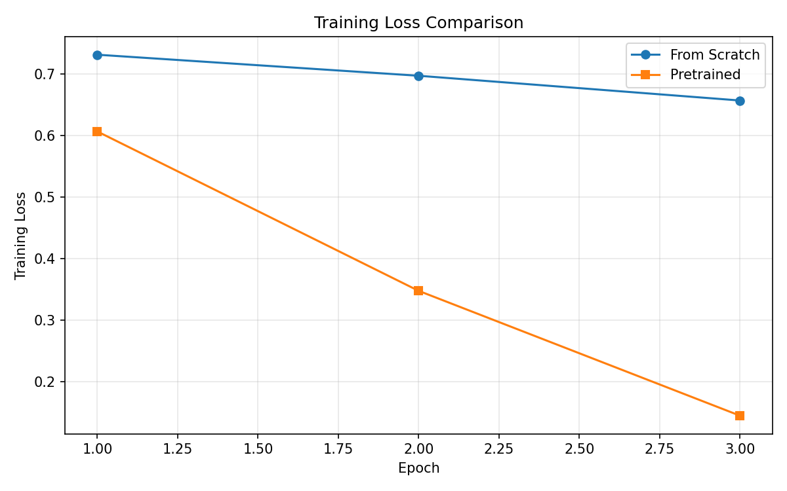

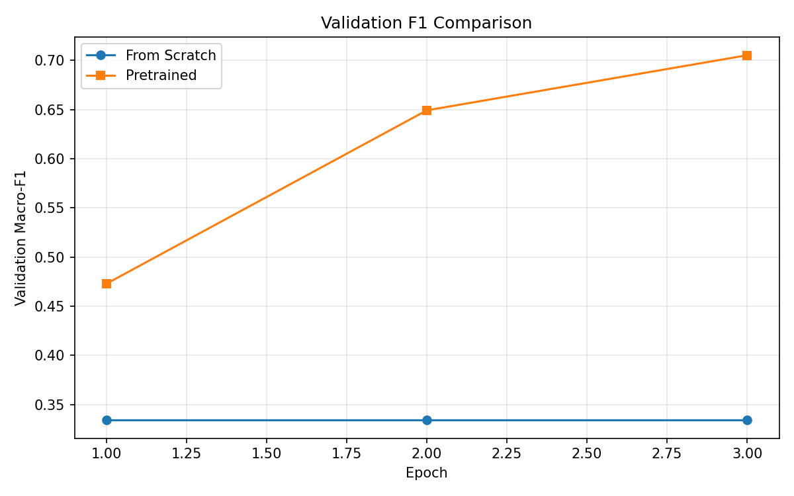

# Experiment 2 — Feature Extraction vs Fine-Tuning

## Train/validation theo epoch

| Mode | Epoch | Train loss | Val loss | Val accuracy | Val F1 |
|---|---:|---:|---:|---:|---:|
| Frozen | 1 | 0.5911 | 0.4902 | 0.7540 | 0.7500 |
| Frozen | 2 | 0.4510 | 0.4430 | 0.8120 | 0.8120 |
| Frozen | 3 | 0.4249 | 0.4420 | 0.8100 | 0.8100 |
| Fine-tuning | 1 | 0.6179 | 0.5926 | 0.6520 | 0.6077 |
| Fine-tuning | 2 | 0.4327 | 0.6212 | 0.6780 | 0.6535 |
| Fine-tuning | 3 | 0.3522 | 0.6705 | 0.7600 | 0.7567 |

## So sánh validation và chi phí huấn luyện

| Mode | Trainable parameters | Best validation F1 | Training time (s) | Peak VRAM (GB) |
|---|---:|---:|---:|---:|
| Frozen | 592,130 | 0.8120 | 232.52 | 0.84 |
| Fine-tuning | 66,955,010 | 0.7567 | 937.85 | 1.81 |

## Kết quả test

| Mode | Accuracy | Precision | Recall | F1 |
|---|---:|---:|---:|---:|
| Frozen | 0.7926 | 0.7925 | 0.7926 | 0.7925 |
| Fine-tuning | 0.7645 | 0.7782 | 0.7636 | 0.7611 |

| Mode | Class | Precision | Recall | F1 | Support |
|---|---|---:|---:|---:|---:|
| Frozen | Negative | 0.79 | 0.79 | 0.79 | 1,238 |
| Frozen | Positive | 0.80 | 0.79 | 0.79 | 1,259 |
| Fine-tuning | Negative | 0.84 | 0.65 | 0.73 | 1,238 |
| Fine-tuning | Positive | 0.72 | 0.88 | 0.79 | 1,259 |

Fine-tuning so với Frozen: **ΔAccuracy = -0.0280**, **ΔF1 = -0.0314**, thời gian huấn luyện **4.03×**.

### Biểu đồ

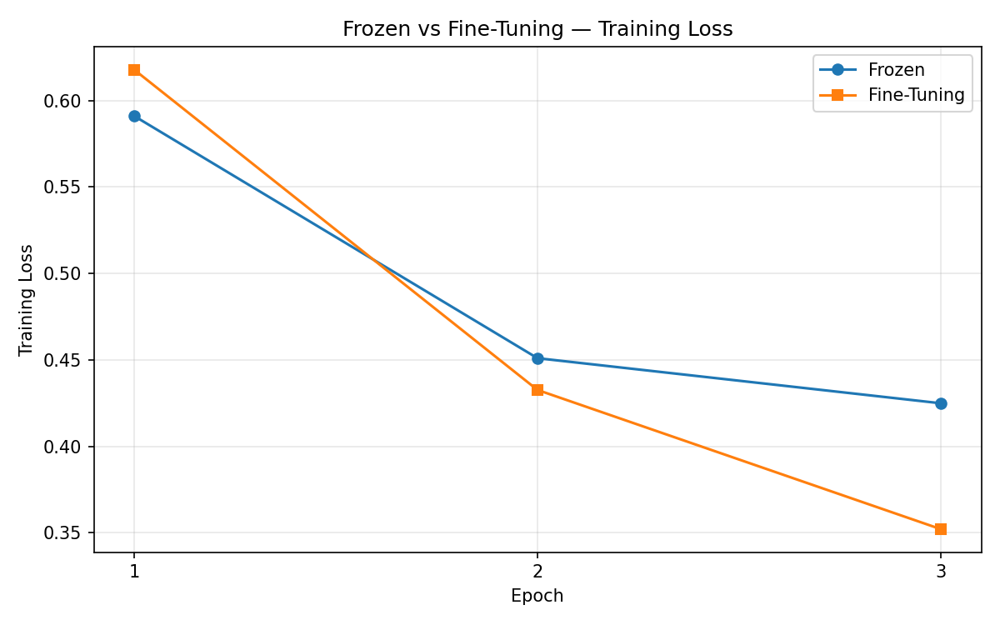

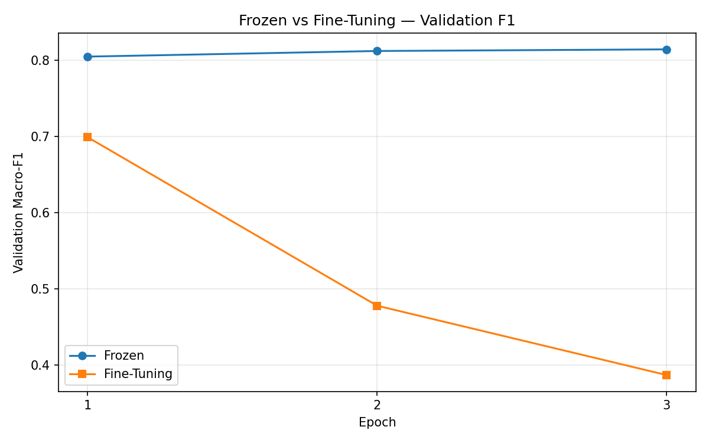

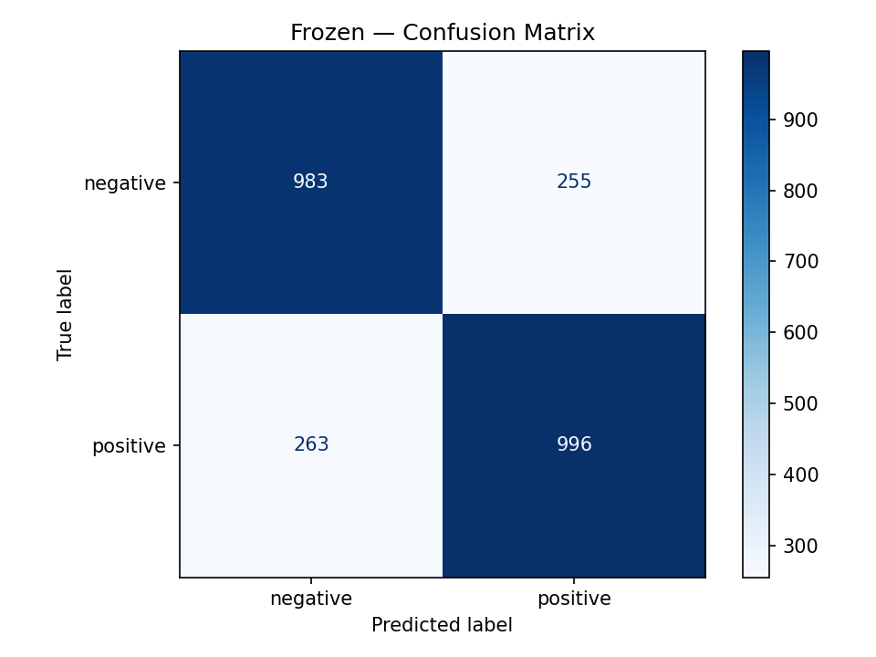

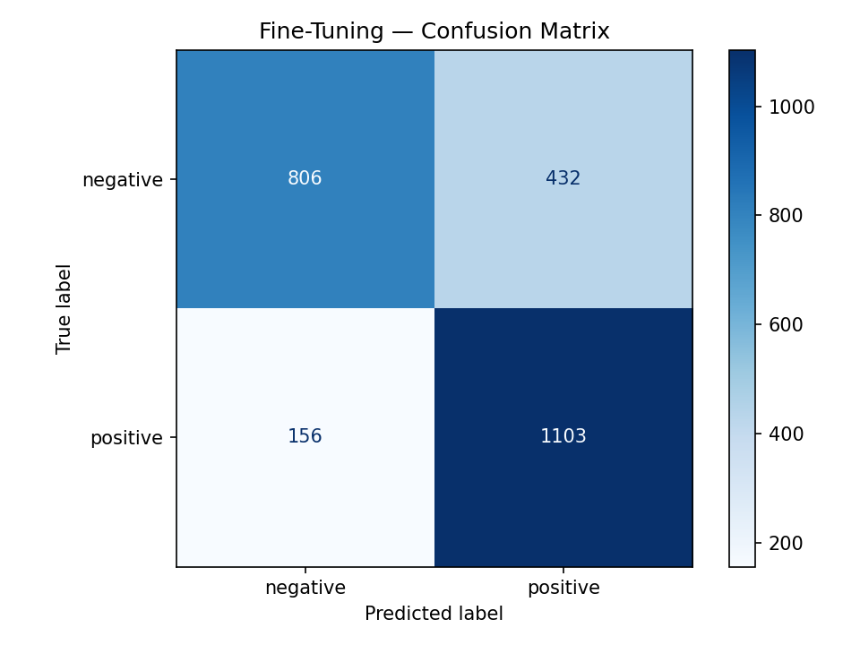

# Experiment 3 — Amount of Training Data

## Train/validation theo epoch

| Training data | Epoch | Train loss | Val loss | Val accuracy | Val F1 |
|---:|---:|---:|---:|---:|---:|
| 10% | 1 | 0.7194 | 0.7058 | 0.5040 | 0.3351 |
| 10% | 2 | 0.7159 | 0.7154 | 0.5040 | 0.3351 |
| 10% | 3 | 0.7041 | 0.6984 | 0.5420 | 0.4428 |
| 25% | 1 | 0.7009 | 0.6844 | 0.5740 | 0.5734 |
| 25% | 2 | 0.6742 | 0.7462 | 0.5060 | 0.3532 |
| 25% | 3 | 0.4639 | 0.6906 | 0.7080 | 0.7057 |
| 50% | 1 | 0.7260 | 0.6932 | 0.4960 | 0.3316 |
| 50% | 2 | 0.7077 | 0.7222 | 0.5040 | 0.3351 |
| 50% | 3 | 0.6955 | 0.6937 | 0.4960 | 0.3316 |
| 100% | 1 | 0.7052 | 0.7052 | 0.5040 | 0.3351 |
| 100% | 2 | 0.7004 | 0.6957 | 0.5040 | 0.3351 |
| 100% | 3 | 0.6984 | 0.6928 | 0.4960 | 0.3316 |

## Kết quả validation và chi phí huấn luyện

| Training data | Samples | Best epoch | Best validation F1 | Training time (s) | Peak VRAM (GB) |
|---:|---:|---:|---:|---:|---:|
| 10% | 199 | 3 | 0.4428 | 96.38 | 1.81 |
| 25% | 499 | 3 | 0.7057 | 241.89 | 1.81 |
| 50% | 998 | 2 | 0.3351 | 483.57 | 1.81 |
| 100% | 1,996 | 1 | 0.3351 | 966.65 | 1.81 |

## Kết quả test

| Training data | Samples | Accuracy | Precision (macro) | Recall (macro) | F1 (macro) | Training time (s) | Best epoch |
|---:|---:|---:|---:|---:|---:|---:|---:|
| 10% | 199 | 0.5238 | 0.6419 | 0.5276 | 0.4066 | 96.38 | 3 |
| 25% | 499 | 0.7080 | 0.7188 | 0.7071 | 0.7038 | 241.89 | 3 |
| 50% | 998 | 0.5042 | 0.2521 | 0.5000 | 0.3352 | 483.57 | 2 |
| 100% | 1,996 | 0.5042 | 0.2521 | 0.5000 | 0.3352 | 966.65 | 1 |

## F1 theo lớp trên test

| Training data | Negative precision | Negative recall | Negative F1 | Positive precision | Positive recall | Positive F1 |
|---:|---:|---:|---:|---:|---:|---:|
| 10% | 0.51 | 0.98 | 0.67 | 0.77 | 0.08 | 0.14 |
| 25% | 0.77 | 0.59 | 0.67 | 0.67 | 0.82 | 0.74 |
| 50% | 0.00 | 0.00 | 0.00 | 0.50 | 1.00 | 0.67 |
| 100% | 0.00 | 0.00 | 0.00 | 0.50 | 1.00 | 0.67 |

Thay đổi F1 macro: 10%→25% **+0.2972**; 25%→50% **-0.3686**; 50%→100% **+0.0000**. Chênh lệch 10%→100%: **Accuracy -0.0196**, **F1 -0.0714**.

### Biểu đồ

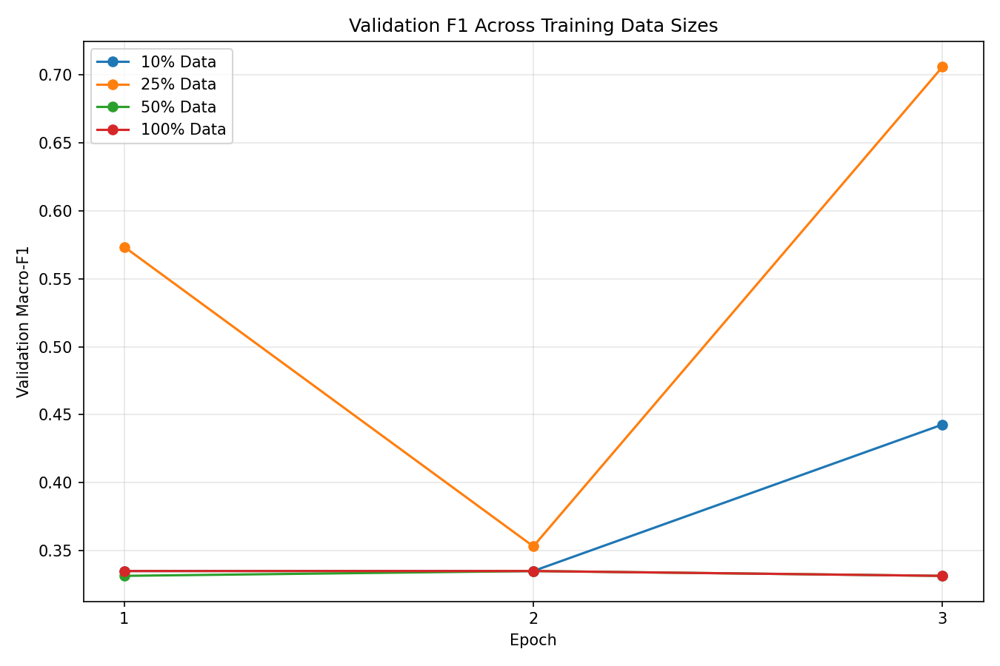

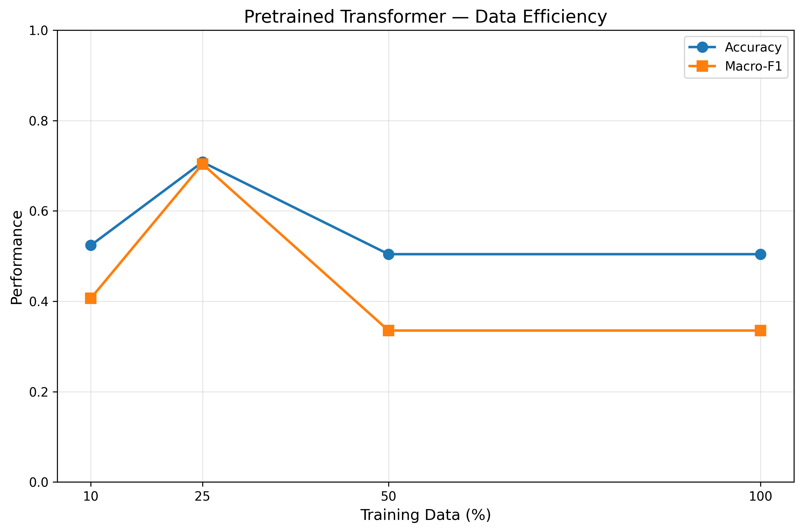

# Experiment 4 — Maximum Sequence Length

## Train/validation theo epoch

| Max length | Epoch | Train loss | Val loss | Val accuracy | Val F1 |
|---:|---:|---:|---:|---:|---:|
| 64 | 1 | 0.7080 | 0.7222 | 0.4820 | 0.3698 |
| 64 | 2 | 0.6788 | 0.6434 | 0.7020 | 0.7020 |
| 64 | 3 | 0.4921 | 0.7222 | 0.6740 | 0.6700 |
| 128 | 1 | 0.7052 | 0.7052 | 0.5040 | 0.3351 |
| 128 | 2 | 0.7004 | 0.6957 | 0.5040 | 0.3351 |
| 128 | 3 | 0.6984 | 0.6928 | 0.4960 | 0.3316 |
| 256 | 1 | 0.6971 | 0.7027 | 0.5040 | 0.3351 |
| 256 | 2 | 0.7117 | 0.6968 | 0.5040 | 0.3351 |
| 256 | 3 | 0.7062 | 0.6933 | 0.4960 | 0.3316 |

## Kết quả validation và test

| Max length | Best epoch | Validation F1 | Test accuracy | Test precision (macro) | Test recall (macro) | Test F1 (macro) | Training time (s) | Peak GPU memory (GB) |
|---:|---:|---:|---:|---:|---:|---:|---:|---:|
| 64 | 2 | 0.7020 | 0.6916 | 0.6916 | 0.6915 | 0.6916 | 528.11 | 1.8066 |
| 128 | 1 | 0.3351 | 0.5042 | 0.2521 | 0.5000 | 0.3352 | 993.54 | 1.8125 |
| 256 | 1 | 0.3351 | 0.5042 | 0.2521 | 0.5000 | 0.3352 | 1,876.36 | 1.8184 |

## F1 theo lớp trên test

| Max length | Negative precision | Negative recall | Negative F1 | Positive precision | Positive recall | Positive F1 |
|---:|---:|---:|---:|---:|---:|---:|
| 64 | 0.69 | 0.68 | 0.69 | 0.69 | 0.70 | 0.70 |
| 128 | 0.00 | 0.00 | 0.00 | 0.50 | 1.00 | 0.67 |
| 256 | 0.00 | 0.00 | 0.00 | 0.50 | 1.00 | 0.67 |

So với max length 64, cấu hình 128 giảm **Accuracy 0.1874** và **F1 0.3564**; thời gian huấn luyện tăng **1.8813×**. Cấu hình 256 không cải thiện Accuracy/F1 so với 128, thời gian huấn luyện bằng **3.5530×** cấu hình 64.

### Biểu đồ

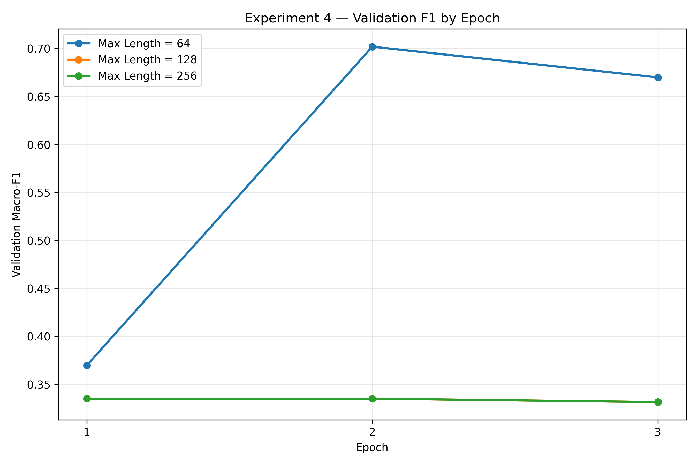

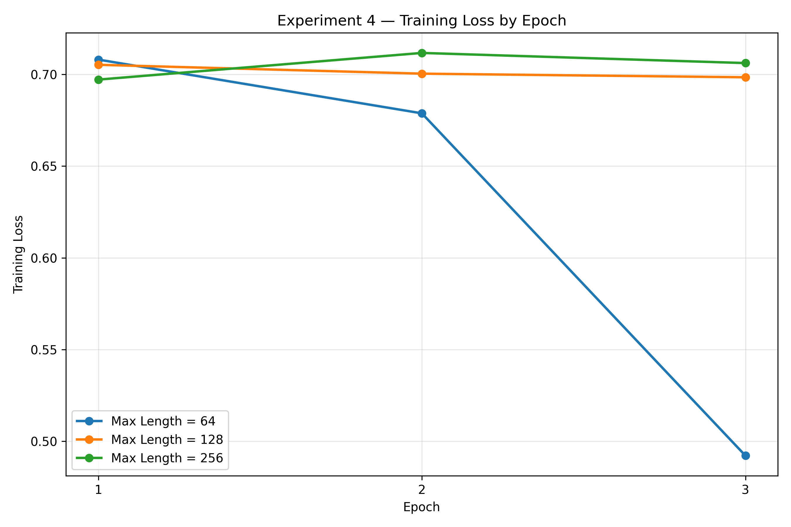

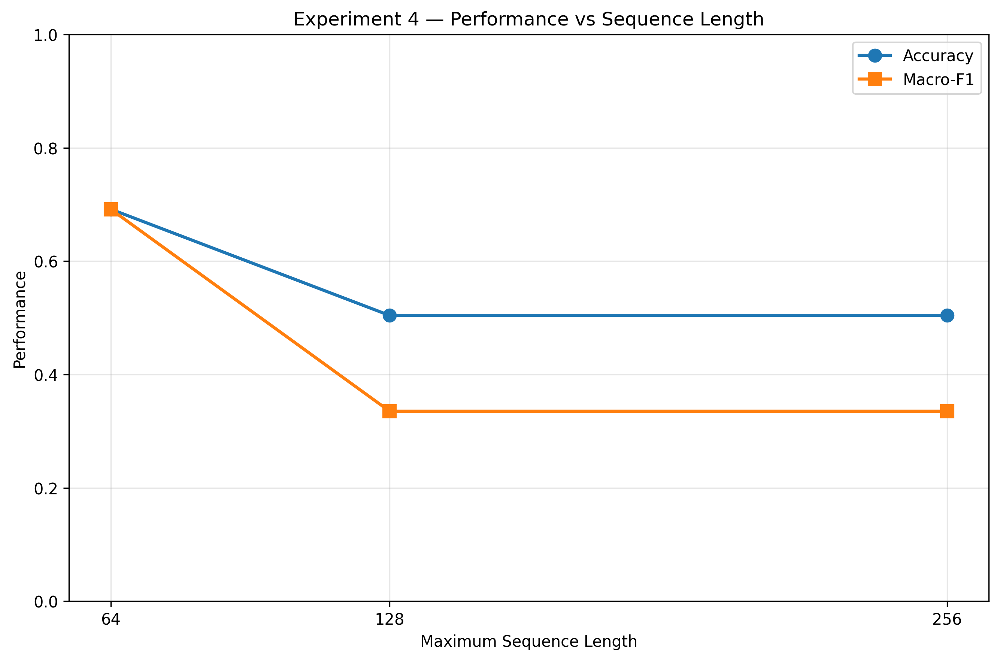

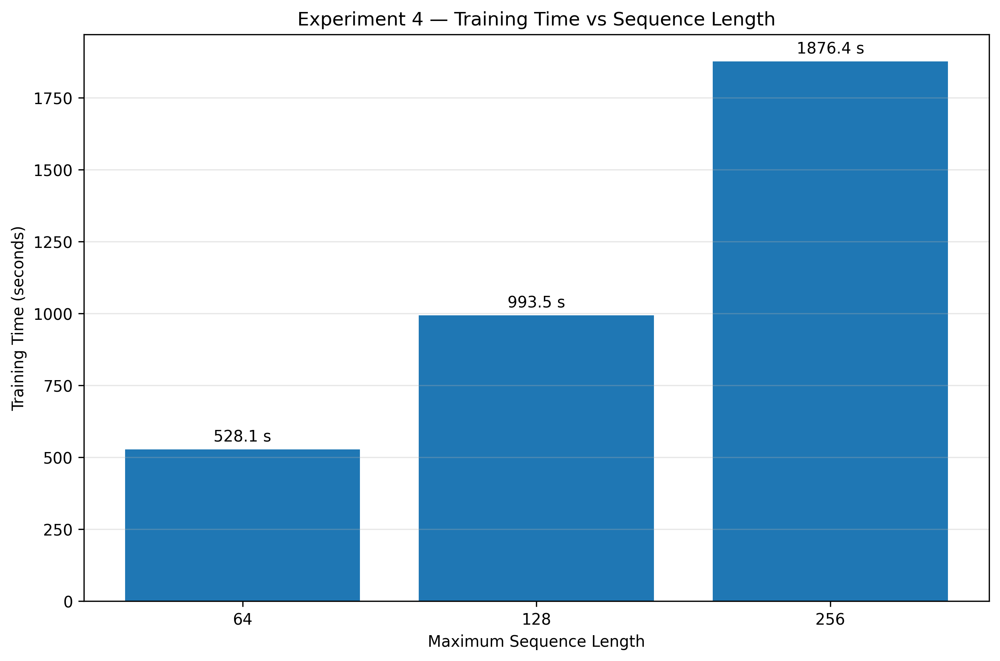

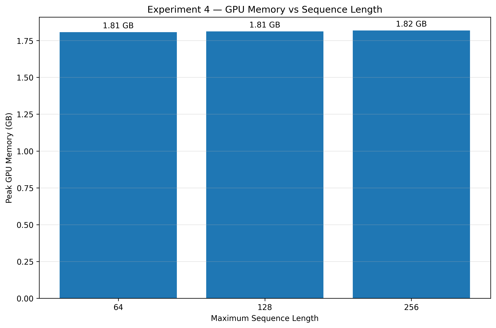

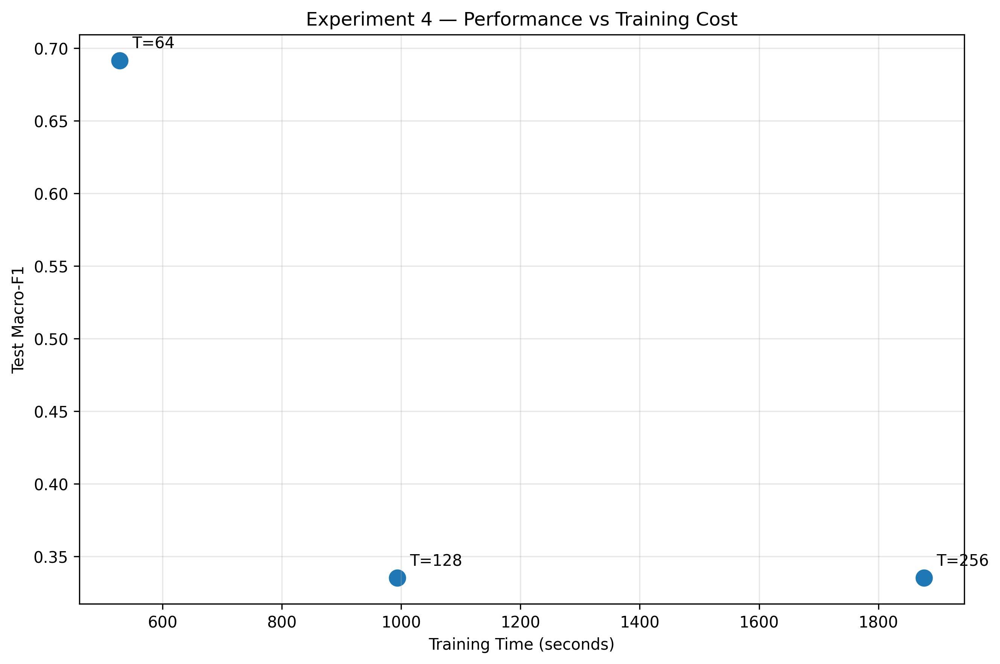

# Experiment 5 — Domain Shift

## Kết quả theo domain

| Domain | Vai trò | Samples | Accuracy | Precision (macro) | Recall (macro) | Macro-F1 | Inference time (s) |
|---|---|---:|---:|---:|---:|---:|---:|
| IMDb | In-domain | 2,497 | 0.7645 | 0.7782 | 0.7636 | 0.7611 | 105.97 |
| Yelp | Out-of-domain | 5,000 | 0.7612 | 0.7666 | 0.7612 | 0.7600 | 209.42 |

Chênh lệch IMDb → Yelp: **Accuracy 0.0033**, **Macro-F1 0.0012** (giảm tương đối **0.15%** F1).

## Kết quả theo lớp

| Domain | Class | Precision | Recall | F1 | Support |
|---|---|---:|---:|---:|---:|
| IMDb | Negative | 0.8378 | 0.6511 | 0.7327 | 1,238 |
| IMDb | Positive | 0.7186 | 0.8761 | 0.7895 | 1,259 |
| Yelp | Negative | 0.8046 | 0.6900 | 0.7429 | 2,500 |
| Yelp | Positive | 0.7286 | 0.8324 | 0.7771 | 2,500 |

## Số lỗi phân loại

| Domain | Errors | Error rate | False Positive | False Negative |
|---|---:|---:|---:|---:|
| IMDb | 588 | 23.55% | 432 | 156 |
| Yelp | 1,194 | 23.88% | 775 | 419 |

### Biểu đồ

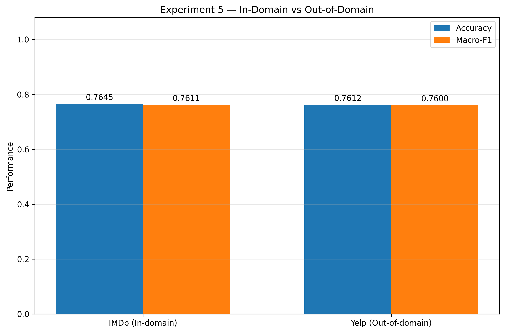

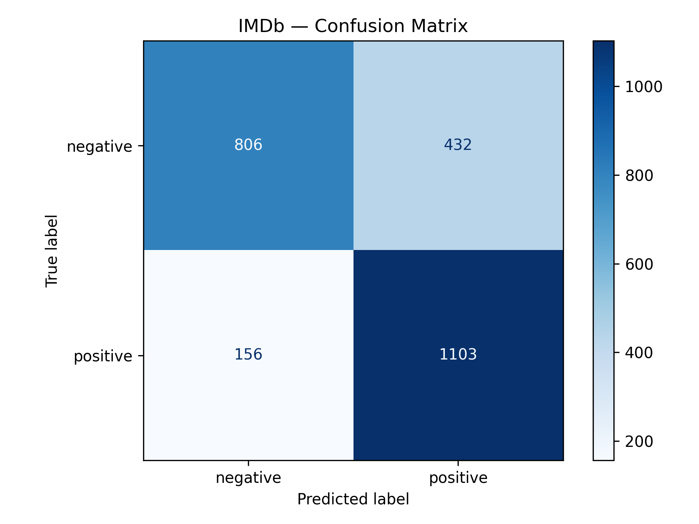

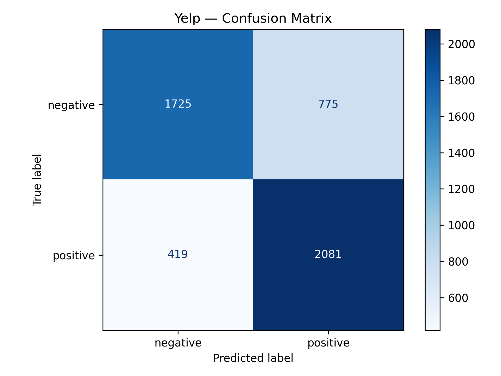

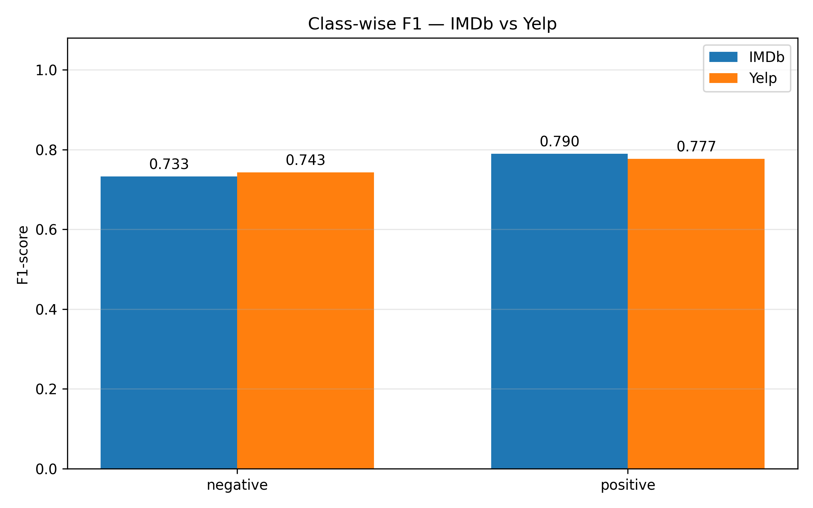

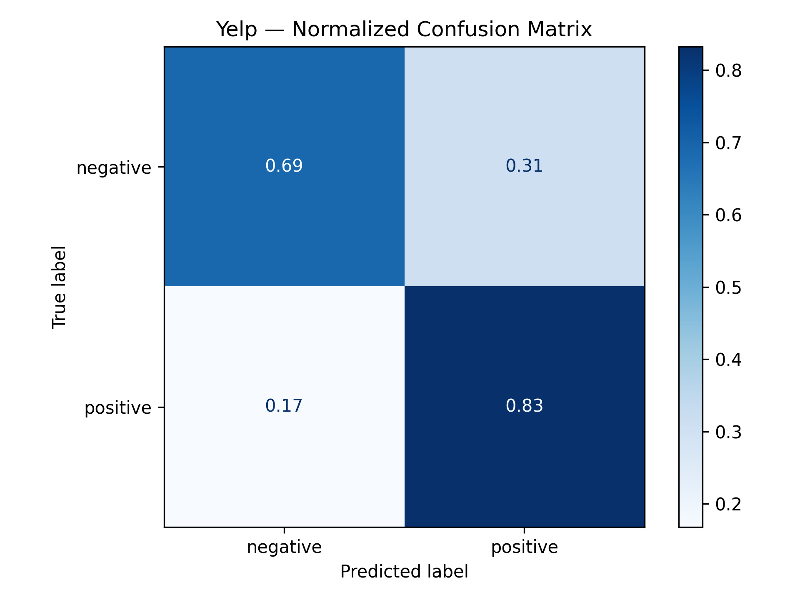

# Application

## Dự đoán mẫu

| Ví dụ | Prediction | Confidence |
|---:|---|---:|
| 1 | Positive | 0.9212 |
| 2 | Negative | 0.9526 |
| 3 | Positive | 0.9208 |
| 4 | Negative | 0.9515 |
| 5 | Positive | 0.9212 |

## Kết quả test của mô hình Fine-Tuning

| Accuracy | Precision | Recall | F1 |
|---:|---:|---:|---:|
| 0.7645 | 0.7782 | 0.7636 | 0.7611 |
